# 🎨 Artify — Digital Art Gallery & Shop

Artify is a Flutter mobile app where users sign in, browse a gallery of famous paintings, like them, comment, add them to a cart and check out. Users can also add / edit / delete paintings and import real artworks from a public art API. Built with **Flutter**, **Provider** and **Supabase**.

> Final project — *Mobile Development using Flutter* — Supervised by Dr. Mostafa Elgendy

## 📌 Project Description
Artify is a digital art gallery and shop. Paintings are stored in the cloud (Supabase Postgres), users authenticate with Supabase Auth, and personal preferences (dark mode, favorites, cart) are stored on the device with SharedPreferences. The **Discover** screen connects to the public Art Institute of Chicago API so users can search real artworks and import them into the gallery.

## 🧩 Problem Statement
Art lovers and small galleries lack a simple mobile app to showcase artworks, interact with them (likes, comments) and buy them. Artify provides a clean, fast and secure gallery experience with cloud-synced data and personal preferences saved on the device.

## ✨ Features
- 🔐 **Authentication** — register, log in, log out (Supabase Auth); the session persists between launches
- 🖼️ **Gallery** — paintings loaded from the cloud with loading, error + retry, and empty states
- 🔎 **Search & filter** — search by title/artist, favorites-only filter, pull-to-refresh
- ❤️ **Favorites** — like paintings (saved locally)
- 💬 **Comments** — read, add and delete your own comments (stored in Supabase)
- 🛒 **Cart & checkout** — cart badge, total price, persisted between launches
- ✏️ **Full CRUD** — add, edit and delete paintings (swipe to delete, with confirmation)
- 🌍 **Discover (public API)** — search the Art Institute of Chicago API and import artworks
- 🌙 **Dark / light mode** — toggle saved locally
- ✅ **Form validation** and friendly **error handling** everywhere (including the offline state)

## 📸 Screenshots

**Authentication**

| Login | Register (validation errors) |
|:---:|:---:|
| 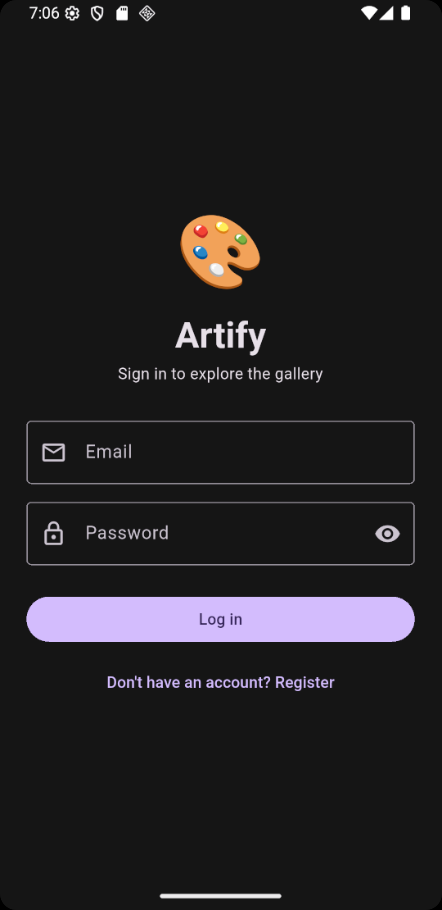 | 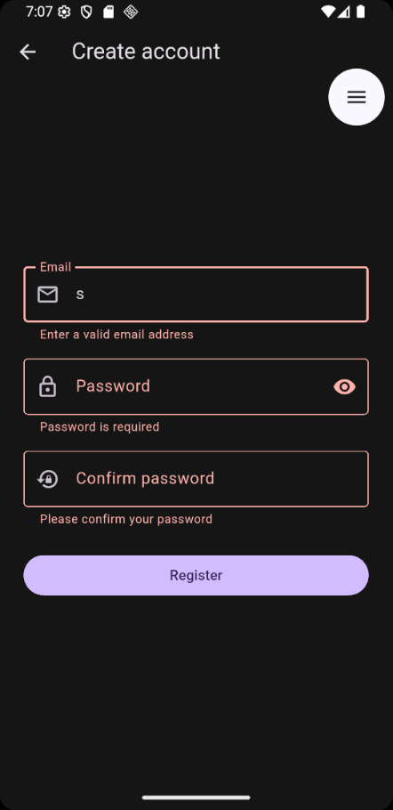 |

**Gallery**

| Home | Favorites | Search |
|:---:|:---:|:---:|
| 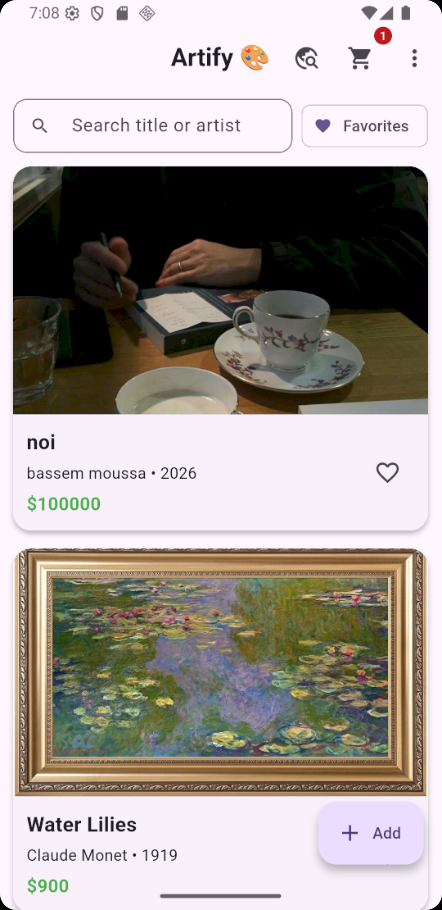 | 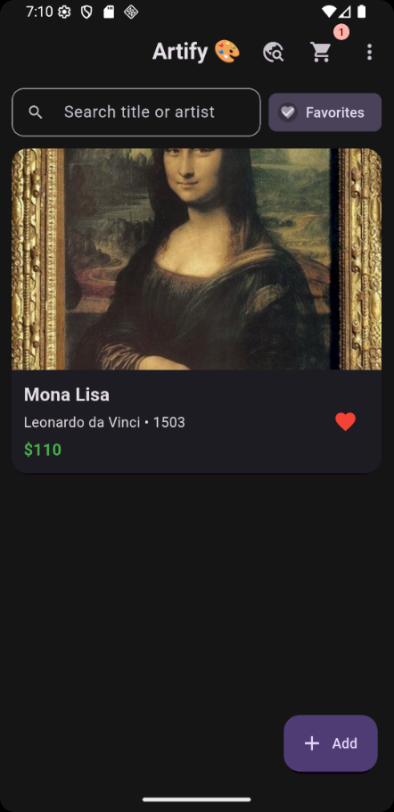 | 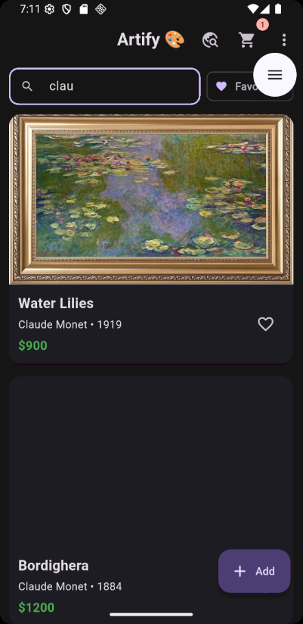 |

**Details, cart and CRUD**

| Details & comments | Cart | Add / Edit form |
|:---:|:---:|:---:|
| 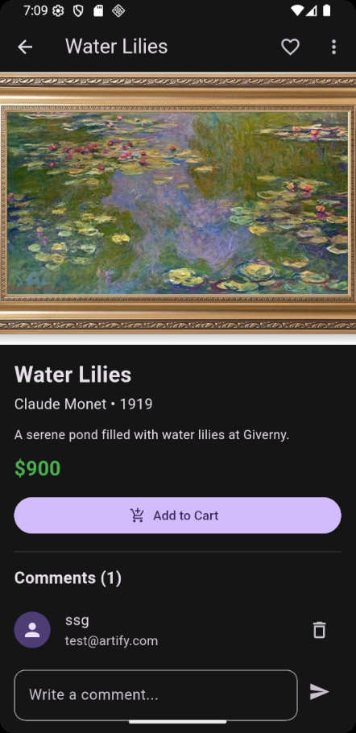 | 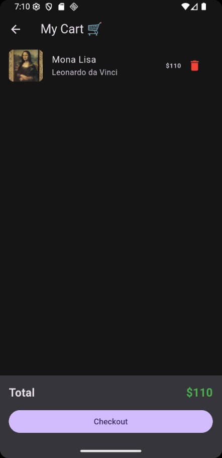 | 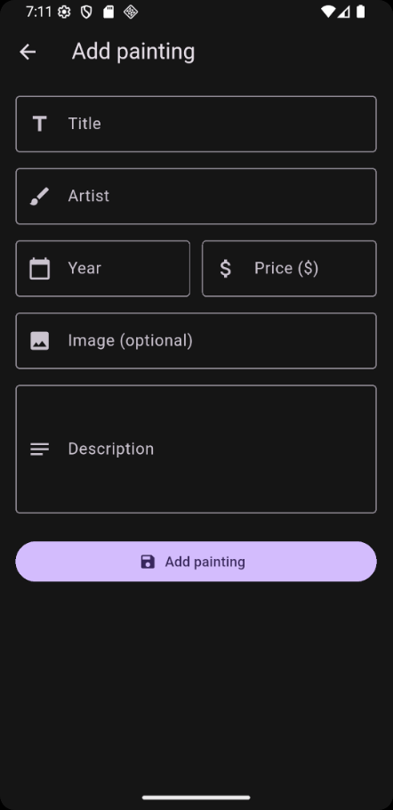 |

**Public API, theme and error handling**

| Discover (API) | Dark mode | Menu (theme & logout) |
|:---:|:---:|:---:|
| 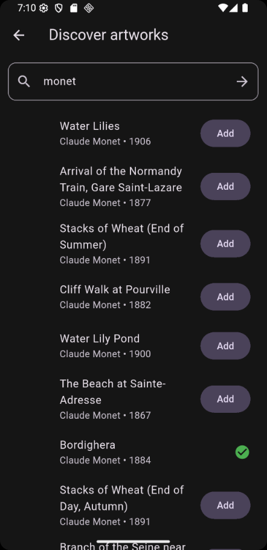 | 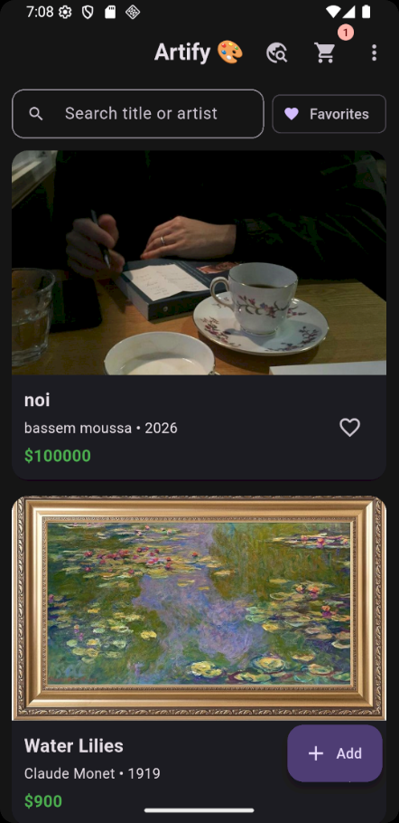 | 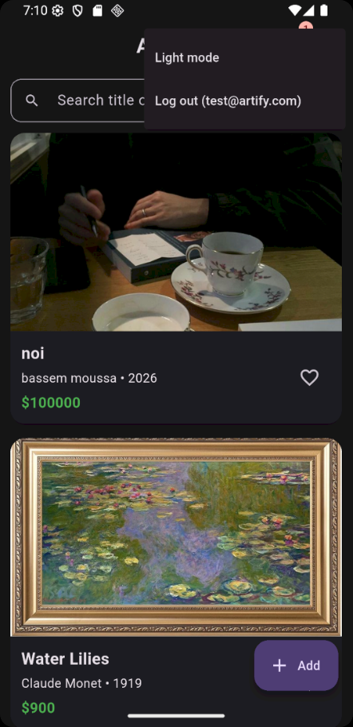 |

| Delete confirmation | No internet + Retry |
|:---:|:---:|
| 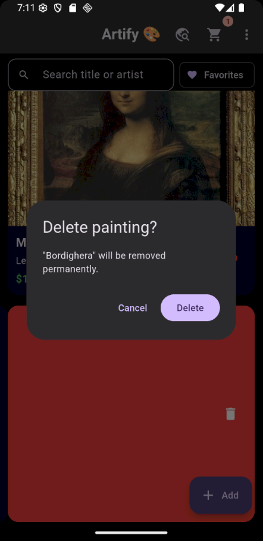 | 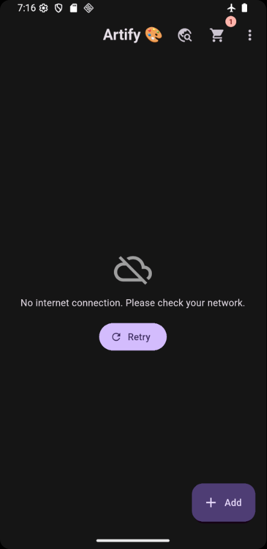 |

## 🧱 System Architecture
```
UI (screens / widgets)  →  Providers (state)  →  Services  →  Supabase (Auth + Postgres)
                                                          →  SharedPreferences (local storage)
                                                          →  Art Institute of Chicago REST API
```
```
lib/
├── main.dart            # app entry, Supabase init, MultiProvider, themes
├── routes.dart          # named routes
├── config/env.dart      # Supabase URL + anon (publishable) key
├── models/              # Painting, Comment
├── services/            # supabase_service, art_api_service, local_storage
├── providers/           # auth, painting, cart, theme (ChangeNotifier)
├── screens/             # auth_gate, login, register, home, details, cart, form, discover
├── widgets/             # painting_card, painting_image, error_view
└── utils/               # validators, error_helper
supabase/schema.sql      # tables, RLS policies, seed data
```

## 🛠️ Flutter Technologies Used
| Technology | Package | Used for |
|---|---|---|
| Flutter / Dart, Material 3 | `flutter` | UI, widgets and layouts |
| State management | `provider` | `AuthProvider`, `PaintingProvider`, `CartProvider`, `ThemeProvider` |
| Backend (Auth + Postgres) | `supabase_flutter` | Authentication, CRUD, comments, Row Level Security |
| Local storage | `shared_preferences` | Dark mode, favorites, cart |
| REST API | `http` | Art Institute of Chicago API (Discover screen) |

## 🎓 Course Topics Covered
| Topic | Where |
|---|---|
| Widgets & layouts | All screens (Column, Row, ListView, Card, Badge, Dismissible, Form…) |
| Navigation & routing | Named routes in `routes.dart` with arguments (`/details`, `/form`, …) |
| State management | Provider — `AuthProvider`, `PaintingProvider`, `CartProvider`, `ThemeProvider` |
| API integration | Supabase REST + Art Institute of Chicago API (`art_api_service.dart`, with timeout and status-code check) |
| Local storage | SharedPreferences — dark mode, likes, cart (`local_storage.dart`) |
| Authentication | Supabase Auth (`supabase_service.dart`) + `AuthGate` (switches Login / Home by session) |
| Supabase | Auth, Postgres tables, Row Level Security |
| CRUD | Paintings (create / read / update / delete, optimistic delete with rollback) and comments |
| Form validation | `Form` + `TextFormField` validators in `validators.dart` |
| Async programming | `async/await`, `Future`, `FutureBuilder`, `StreamBuilder` |
| Error handling | `try/catch/finally`, `friendlyError()` in `error_helper.dart`, SnackBars, Retry button |

## 🧗 Challenges & How I Solved Them
| Challenge | Solution |
|---|---|
| Name clash: `LocalStorage` exists in my code and in `supabase_flutter` | Imported the package with `hide LocalStorage` |
| Images not showing: asset names did not match the database | Unified the names as `.jpg` in `assets/images/` and in the database |
| `anonKey` is deprecated in `Supabase.initialize` | Switched to `publishableKey` |
| Empty database after setup | Added `supabase/schema.sql` (tables, RLS policies, seed data) |
| Data mismatch between a painting record and its image | Updated the record to match its image |

## 🚀 Getting Started
1. **Clone** the repo and install packages:
   ```bash
   git clone https://github.com/BassemMoussa/artify-.git
   cd artify-
   flutter pub get
   ```
2. **Create a Supabase project** at [supabase.com](https://supabase.com).
3. Open **SQL Editor** and run `supabase/schema.sql`.
4. (For easy testing) go to **Authentication → Providers → Email** and turn **off** "Confirm email".
5. Copy your **Project URL** and **anon / publishable key** (Project Settings → API) into `lib/config/env.dart`, or run:
   ```bash
   flutter run --dart-define=SUPABASE_URL=https://xxxx.supabase.co --dart-define=SUPABASE_ANON_KEY=your_key
   ```
6. Make sure the painting images are in `assets/images/` (`1.jpg` … `6.jpg`).
7. Run the app: `flutter run`

> Android release builds need `<uses-permission android:name="android.permission.INTERNET"/>` in `android/app/src/main/AndroidManifest.xml`.

## 👥 Team Members
| Name | Role |
|---|---|
| Bassem Ashraf Mohamed Mahmoud Moussa | Developer (individual project) |

**Supervisor:** Dr. Mostafa Elgendy — *Mobile Development using Flutter*
